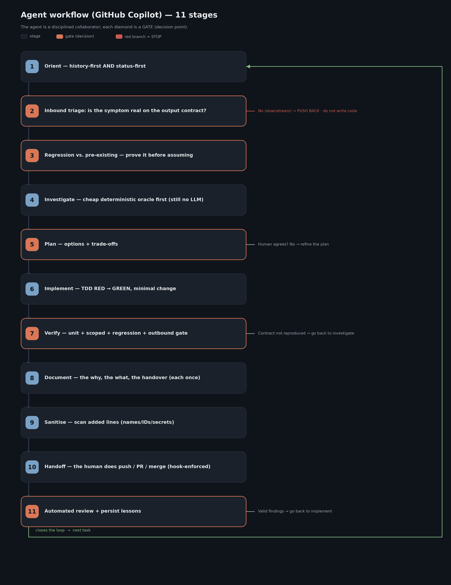

# The real working methodology — with GitHub Copilot

How the **same** 11-stage course methodology (born in Claude Code, ported to Cursor) is applied using
**GitHub Copilot** as the agent. Not an ideal template: the production flow, with the adapted surface
(`AGENTS.md` + `.instructions.md`, skills, MCP, hooks).

| File | What it is |
|---|---|
| [`WORKFLOW.md`](./WORKFLOW.md) | The 11 stages + two-level memory, with Copilot tools. |
| [`REAL_EXAMPLE.md`](./REAL_EXAMPLE.md) | A concrete case (empty field) through the 11 stages. |
| [`tools.md`](./tools.md) | Prevalence: CodeGraph, Serena, Playwright, skill `kg`, oracles. |
| [`machine-sync.md`](./machine-sync.md) | Ops runbook (tarball bring-up + evolution to S3); Copilot adaptation note at the top. |
| [`s3-sync/`](./s3-sync/) | The real (genericised) shared-record scripts — start from `config.env.example`. |
| [`tools/`](./tools/) | **Two real read-only tools**, genericised, with offline tests: a Jira/Confluence client that only sends GET (plus the one write path, to Confluence, with a human OK per page) and the evidence-capture core (which S3 version a run actually used). |
| [`../../docs/synchro/s3-sync/README.md`](../../docs/synchro/s3-sync/README.md) | Shared engineering record on S3 (sync vs mount, roles, identity, guard both directions). |
| [`../../docs/KNOWLEDGE_GRAPH.md`](../../docs/KNOWLEDGE_GRAPH.md) | Ticket graph (graphify) — same scripts; skill `kg` in Copilot. |
| [`../../docs/ai-agents-code-methodology/COPILOT_ADAPTATION.md`](../../docs/ai-agents-code-methodology/COPILOT_ADAPTATION.md) | Full adaptation pack. |
| [`flow.png`](./flow.png) | Flow diagram (source `flow.mmd`, render `render_flow.py`). |

## Central idea

> **The agent is a disciplined collaborator, not an autopilot. Autonomy is earned decision-by-decision.**

Deterministic gates (contract, oracle, tests, sanitise, human on externals) — same as in Claude Code and Cursor.

## Copilot surface (what lives where)

| Role | Claude Code | Cursor | Copilot |
|---|---|---|---|
| Always-on orientation | `CLAUDE.md` | `AGENTS.md` + `.cursor/rules/` | `AGENTS.md` + `.github/copilot-instructions.md` + `.github/instructions/*.instructions.md` |
| Skills `kg`, sanitise… | `~/.claude/skills/` | `.cursor/skills/` | `.github/skills/` or `~/.copilot/skills/` (⚠️ the CLI does not read `~/.claude/skills/`) |
| MCP | `.mcp.json` / `claude mcp add` | `.cursor/mcp.json` | `.mcp.json` (`mcpServers` + `tools`) / `.vscode/mcp.json` (`servers`) / cloud: repo settings |
| Hard gates | hooks + allowlist | `.cursor/hooks.json` | `.github/hooks/*.json` `preToolUse` deny / exit 2 (+ `--deny-tool` per run) |
| Plan gate | Plan mode | Plan mode | `/plan`, `--plan`, Shift+Tab — enforced at the tool layer |
| External handoff | the human | the human (rules/hooks block push) | the human — the hook blocks push/PR/merge; the cloud agent cannot merge by design |

## How it fits with the tools

- **GSD** ([`../gsd/`](../gsd/)) — **Claude Code–only** plugin; in Copilot use plan mode + `/fleet` + role agents.
- **Skill `kg`** — same graphify scripts; pack `docs/ai-agents-code-methodology/copilot/skills/kg`.
- **CodeGraph / Serena** — MCP in `.mcp.json`; **Playwright** is built into the CLI.
- **Docker** — outbound check in the deployed image (same).

## Portability

Starter kit: [`../../docs/ai-agents-code-methodology/`](../../docs/ai-agents-code-methodology/)
(`COPILOT_ADAPTATION.md` + the ready-to-copy [`copilot/`](../../docs/ai-agents-code-methodology/copilot/) surface).
