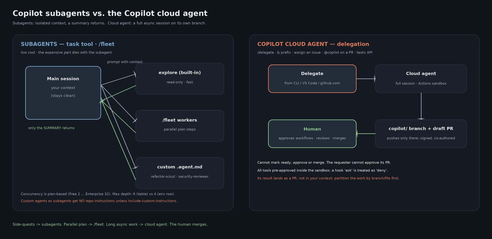

# Subagents, custom agents and delegation (GitHub Copilot)

How to scale from *one* agent to *several* in Copilot. Facts: findings §9
([`../../docs/research/COPILOT_FINDINGS_2026-10-17.md`](../../docs/research/COPILOT_FINDINGS_2026-10-17.md)).

> Claude Code's **Agent Teams** (lead + teammates + shared task list) have no 1:1 port. Copilot's nearest
> pieces: `/fleet` (parallel subagents for a plan), **background subagents you can message**
> (`write_agent`), **sidekick agents**, multiple sessions, and `/delegate` to the cloud agent.

---

## 1. Built-in subagents (CLI)

| Agent | Default model per the docs / note |
|---|---|
| `code-review` | claude-sonnet-4.6 · will not modify code |
| `explore` | gpt-5.4-mini · fast, parallel-safe, < 300-word answers |
| `general-purpose` | |
| `research` | |
| `rubber-duck` | complementary-model critique |
| `security-review` | |
| `task` | runs tests and builds |

⚠️ **Doc inconsistency:** these built-in default models (`claude-sonnet-4.6`, `gpt-5.4-mini`) differ from the
CLI default model table (`claude-sonnet-5.5`). Verify on your build.

- **Spawning:** the `task` tool, plus `list_agents`, `read_agent`, `write_agent` (background agents can be messaged).
- **Limits:** concurrency is plan-based — Free 2, Pro 4, Max 8, Business 16, Enterprise 32
  (`COPILOT_SUBAGENT_MAX_CONCURRENT`). Max **depth: 6 per the reference table, 4 per the env-var row**
  (`COPILOT_SUBAGENT_MAX_DEPTH`) — a documentation contradiction; set it explicitly if it matters.
- **Parallel:** `/fleet` or `--fleet`; `/tasks` to watch them. **Sidekick agents** (`sidekick:` with
  `triggers: [user.message, session.context_changed]`) run in the background and post to the session inbox.
- **VS Code Local harness:** the `runSubagent` tool (`agent/runSubagent`); a coordinator lists `agents: [...]`;
  nested subagents need `chat.subagents.allowInvocationsFromSubagents`.

The reason is the same as everywhere: **context isolation**. A side-quest that reads 15 files must not flood
your thread; the subagent dies and leaves you a summary.

## 2. Custom agents — `.github/agents/*.agent.md`

| Scope (CLI priority order) | Path |
|---|---|
| User | `~/.copilot/agents/` |
| Project | `.github/agents/` (cwd → git root; deepest wins) |
| Claude compat | `.claude/agents/` |
| Others | `--add-dir` roots, plugin `agents/`, org/enterprise (`/agents` in the org's `.github` repo) |

Frontmatter that matters: `description` (required in CLI + cloud), `name`, **`tools`** (aliases `read`, `edit`,
`search`, `execute`/`shell`, `agent`, `web`, `todo`, `server/*`; `[]` = none), `model`, `target`,
`user-invocable`, `disable-model-invocation`, `mcp-servers` (CLI + cloud), `include-custom-instructions` (CLI).
`handoffs[]` and `agents[]` are **VS Code Local only** (the cloud agent ignores them).

Examples in this folder (read-only by their `tools` list — that is the enforcement, not the prose):

- [`.github/agents/refactor-scout.agent.md`](./.github/agents/refactor-scout.agent.md) — CodeGraph → Serena → text search; verdict SAFE/RISKY/STOP.
- [`.github/agents/security-reviewer.agent.md`](./.github/agents/security-reviewer.agent.md).

Run them: `copilot --agent refactor-scout`, name them in a prompt, or `/fleet … use @refactor-scout`.

⚠️ **Gotcha:** a custom agent spawned as a subagent gets **no** repo instructions unless
`include-custom-instructions: true` — put everything it needs in the agent file or the launch prompt.

Lightweight alternative (no agent file): prompt templates in [`prompts/`](./prompts/) —
[`refactor-scout.md`](./prompts/refactor-scout.md) · [`security-reviewer.md`](./prompts/security-reviewer.md).

## 3. Delegation to the cloud agent

`/delegate` or a `&` prompt prefix (CLI), VS Code Session Target → Cloud, assigning an issue to Copilot,
`@copilot` on a PR, the Agents page, or the REST tasks API ([`../automation/`](../automation/)). The cloud agent
runs a full session in an ephemeral Actions sandbox, pushes **only** to its own `copilot/` branch, opens a draft
PR, and **cannot mark ready, approve or merge**.

## 4. Which one?

| | Subagent / `/fleet` | Cloud agent |
|---|---|---|
| Context | Isolated; a summary returns | Full session, async |
| Result | Text back into your session | A branch + draft PR |
| Cost | Low | Higher (a full session) |
| Ideal | Side-quests, scouting, review | Long, well-specified tasks you review as a PR |

**Methodology link:** `refactor-scout` encodes CodeGraph → Serena. GSD packaged similar roles as a Claude Code
plugin; in Copilot the roles live as custom agents/skills/prompts ([`../gsd/`](../gsd/)).

`agents.png` is regenerated with `python render_agents.py` (Pillow, offline; conceptual source: `agents.mmd`).
